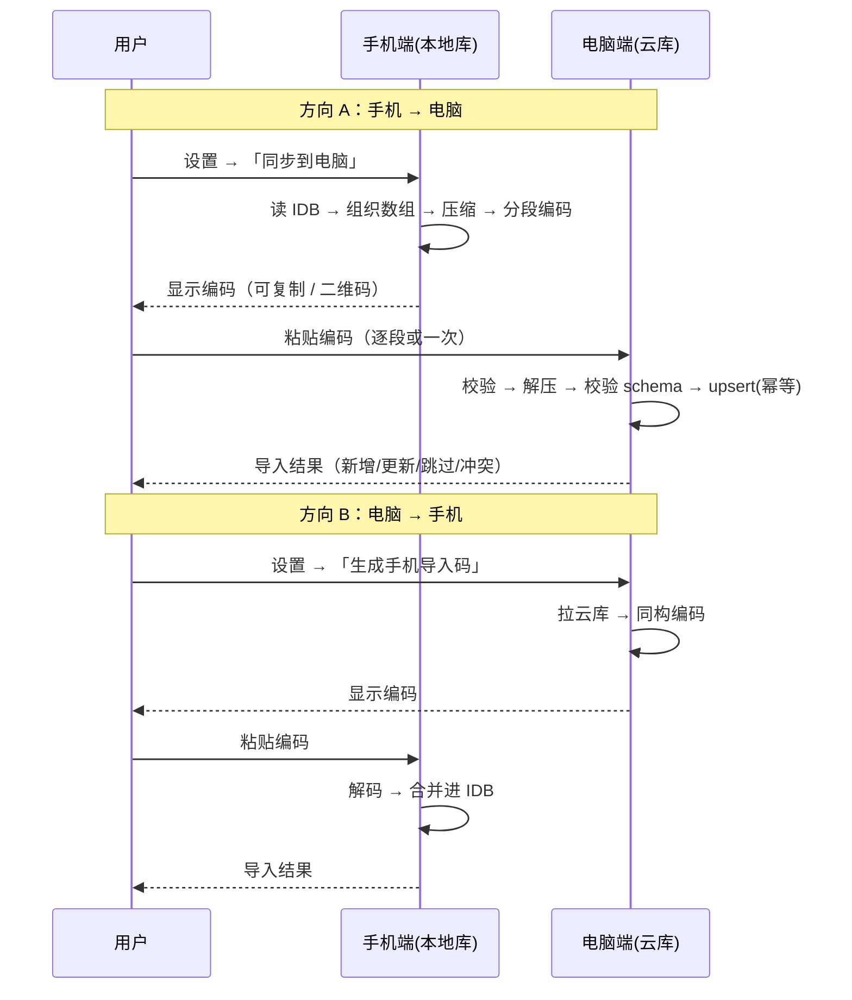

# 免登录手机端 ⇄ 已登录电脑端：编码同步方案（v1 设计）

> 状态：设计稿（未实现）　适用版本：v2.15+　作者：主理人整理
>
> 一句话：**手机端不登录、数据全在本地；要同步时，手机把记录组织成一个数组，压成一段（或几段）可复制的文本编码，用户在电脑端粘贴还原，反之亦然。**

---

## 1. 背景与目标

| 端 | 登录态 | 数据位置 | 联网 |
|---|---|---|---|
| 手机（APK） | **永不需要登录** | 本机 IndexedDB | 联网（加载线上 UI，但读写本地） |
| 电脑（桌面端 / 网页版） | 需要登录 | 云端（RLS 按 `owner_id` 隔离） | 联网 |

**硬约束（来自云服务现状）**：云 SDK 没有匿名登录接口，`signUp` 必须先过短信验证码，RLS 按 `owner_id` 判定。因此「免登录还能直接读写云端」在技术上不成立 —— 这就是本方案存在的理由。

**目标**
1. 手机端离线可用、无需账号；
2. 两端之间能**人工可控**地搬运数据，不依赖任何中间服务器；
3. 传输过程可校验、可断点、可幂等重放；
4. 不引入新的云端表、不新增 DDL。

**非目标**：实时双向同步、自动冲突合并、多人共享。

---

## 2. 总体流程



两个方向**共用同一套编解码器**，只是「写入目标」不同。

---

## 3. 各端职责

| 环节 | 手机端（免登录） | 电脑端（已登录） |
|---|---|---|
| 数据源 | 本地 IndexedDB 全量记录 + 本地设置白名单 | 云库 `records` + `settings` 白名单键 |
| 编码 | 采集 → 规范化 → 压缩 → 分段 → Base32 | 同左（同一 `shared/sync/codec`） |
| 传输 | 展示、复制、可选二维码 | 输入框 / 分段收集器 / 摄像头扫码 |
| 解码 | 同左 | 同左 |
| 落库 | 写 IndexedDB（按 `uid` 覆盖） | 写云库 `records`（`owner_id` 由会话决定） |
| 冲突策略 | `updatedAt` 大者胜；带 tombstone 才能删 | 同左 |
| 失败处理 | 段缺/CRC 错 → 提示重输该段 | 同左 |

**关键分工原则**：编解码是**纯函数**，放 `shared/sync/`，两端 `import` 同一份，避免「手机能编、电脑解不开」。

---

## 4. 数据组织（数组结构）

### 4.1 信封

```jsonc
{
  "v": 1,                       // 协议版本，遇到不认识的 v 直接拒绝（不许猜）
  "sid": "9f3a2c7d",            // 本次同步会话 id，用于分段归位 + 防串包
  "dir": "phone2pc",            // phone2pc | pc2phone
  "at": "2026-11-17T16:00:00Z", // 生成时刻
  "src": "android",             // 来源端标识（android | desktop）
  "mode": "full",               // full | delta（v1 只做 full）
  "count": 42,                  // 记录条数
  "digest": "1f4b9c2e",         // 整包 SHA-256 前 8 位（十六进制）
  "records": [ /* 见 4.2 */ ]
}
```

### 4.2 记录裁剪规则（重要：只传「可重放的事实」，不传本端自增 id）

| 原字段 | 处理 |
|---|---|
| `id`（云端自增 / 本地自增） | **丢弃**，改用 `uid` 作为跨端身份 |
| `uid`（新增） | 取 `externalUid`；没有则生成 `sha1(type + createdAt + title).slice(0,16)`，两端各自补算，保证同一记录算出同一个 uid |
| `content` | 全文保留（这是主价值），但单条超过 8KB 时截断并在 `truncated: true` 标注 |
| `filePath` / 图片 | **不传二进制**，只传路径；接收端标记 `assetMissing: true`（见 §11 待确认） |
| `linkMeta` | 只保留 `title/description/siteName`，丢弃抓取时的临时字段 |
| 时间类 | 一律 ISO 8601 带 Z（UTC），避免两端时区差异 |
| 循环规则 `recurrence` | 原样传（JSON 结构稳定） |
| 关系（`record_links`） | v1 **不传**（见 §11） |

```jsonc
{
  "uid": "9c1f2a7b3d4e5f60",
  "type": "note|link|todo|idea|...",
  "title": "…",
  "content": "…",
  "url": null,
  "category": "工作",
  "tags": ["a", "b"],
  "summary": null,
  "todoStatus": "doing|null",
  "priority": 2,
  "remindAt": "2026-11-18T01:00:00Z",
  "recurrence": null,
  "someday": false,
  "snoozedUntil": null,
  "snoozeCount": 0,
  "createdAt": "2026-11-01T02:03:04Z",
  "updatedAt": "2026-11-16T09:08:07Z",
  "deletedAt": null
}
```

> 删除必须用 **tombstone**（`deletedAt` 非空）参与传输，否则「电脑端删了，手机一同步又活过来」。

### 4.3 采集范围（避免体积失控）

默认只采：**最近 90 天的记录 + 所有未完成待办 + 所有置顶/收藏**。界面上给「范围：近 7 天 / 近 30 天 / 全部」，并实时显示预估段数。

---

## 5. 编码规范（v1）

### 5.1 编码流水线

```
记录数组
  → JSON.stringify（键序固定，便于 digest 稳定）
  → TextEncoder → UTF-8 字节
  → deflate-raw（CompressionStream('deflate-raw')）
  → 按 CHUNK 切分（默认 512 字节）
  → 每片：CRC32(payload) + seq/total + sid
  → Base32（Crockford）编码
  → 每 4 字符插一个空格（便于朗读/手抄，解析时忽略）
```

**为什么 Base32 而不是 Base64**：Base64 有 `+/=`，在聊天软件里会被转义、换行错乱；Crockford Base32 只用 `0-9 A-Z`（去掉 `I L O U`，避免 1/I、0/O 混淆），大小写不敏感，复制粘贴/朗读都稳。

**为什么 deflate-raw 而不是 gzip**：少 18 字节头，且浏览器/WebView 原生支持（Chrome 80+ / Android WebView 现代版本均可用）；不支持时降级为「不压缩 + 段数标注 `raw`」。

### 5.2 单段格式（面向人）

```
PA1·<sid4>·<seq>/<total>·<crc4>·<body>
```

示例：

```
PA1·9f3a·01/03·7B2E·GXQ4 ZK7M 3PNV ...
```

| 位置 | 含义 | 校验规则 |
|---|---|---|
| `PA1` | 协议标识 + 版本 | 不匹配直接提示「编码版本不支持」 |
| `sid4` | 会话 id 前 4 位 | 不同 sid 的段不允许混拼（防串包） |
| `seq/total` | 第几段 / 总段数 | 段可乱序输入，按 seq 归位 |
| `crc4` | 该段解压前字节的 CRC32 前 4 位（十六进制） | 不一致 = 该段被截断/改坏，要求重抄 |
| `body` | Base32 负载 | 长度必须是 8 的倍数（补齐位已含） |

整包校验：首段 body 解出的信封里带 `digest`（整包 SHA-256 前 8 位），集齐后复核一次，不一致则整包作废。

### 5.3 容量预算（决定「单码」还是「分段」）

| 场景 | 条数 | 未压缩 | deflate 后 | Base32 字符量 | 段数（512B/段） |
|---|---|---|---|---|---|
| 少量（近 7 天） | ~15 | ~12 KB | ~4 KB | ~6.5 K | **13 段** |
| 中量（近 30 天） | ~60 | ~48 KB | ~16 KB | ~26 K | **52 段** |
| 全量（500 条） | 500 | ~400 KB | ~130 KB | ~210 K | **≈400 段** |

**结论（必须诚实告知用户）**：编码方案适合**小批量**。超过 20 段时，逐段复制粘贴的体验会崩，必须降级：

1. **≤ 8 段**：直接显示全部编码，一次复制；
2. **9–30 段**：分段展示 + 「复制下一段」按钮 + 进度条；
3. **> 30 段**：改为**二维码帧**（每帧一个段，PC 用摄像头连扫）或**同局域网直传**（电脑起临时 HTTP，手机 POST）。v1 先做 1、2，第 3 档留接口。

### 5.4 可选口令加密（默认关）

若勾选「用口令保护」：

```
key = PBKDF2-SHA256(passphrase, salt16, 150000) → AES-GCM-256
信封明文字段：{ v, sid, at, enc: "aesgcm", salt, iv } ，records 全在密文里
```

口令**不进编码**，必须另外口头/当面告知；代价是输错口令只能重来（GCM 无中间态）。

---

## 6. 传输环节

| 通道 | 适用 | 注意 |
|---|---|---|
| 剪贴板 → 微信/QQ 发给自己 → PC 粘贴 | 最常用 | 微信会折叠长文本，建议分段发 |
| 系统「跨设备剪贴板」（如华为/小米多屏协同） | 同账号设备 | 最省事，直接粘贴 |
| 二维码逐帧扫 | 中大批量 | PC 端需要摄像头权限 |
| 手抄/朗读 | 应急（如电脑没网） | 每段带 CRC，抄错能立刻发现 |

**不做的事**：不把编码发到任何第三方服务、不写进 URL query（会被日志留存）。

---

## 7. 还原与合并

### 7.1 解码流程

```
粘贴 → 去空格/统一大写 → 正则拆 5 段 → 校验 PA1/sid → CRC32 复核
  → 按 seq 落位（重复段：内容一致则忽略，不一致则报「段冲突」）
  → 集齐后按 seq 拼接 → inflate → JSON.parse
  → schema 校验（字段类型/枚举/时间格式）
  → 复核 digest
  → 逐条 upsert
```

### 7.2 幂等与冲突

| 情况 | 处理 |
|---|---|
| `uid` 不存在 | 新增 |
| `uid` 存在，来方 `updatedAt` 更新 | 覆盖可写字段 |
| `uid` 存在，来方 `updatedAt` 更旧 | 跳过，计入「已是最新」 |
| 来方带 `deletedAt` | 本地执行软删除（也写 tombstone），不物理删 |
| 同 `uid` 但 `type` 不同 | 视为冲突，跳过并列入报告（不猜） |

**幂等保证**：同一份编码重复导入 N 次，结果一致（因为按 `uid` + `updatedAt` 判定）。

### 7.3 结果报告

导入结束必须给出可核对的数字：

```
共 42 条：新增 30 · 更新 8 · 跳过 3（已是最新）· 冲突 1（uid=9c1f…，type 不一致）
```

---

## 8. 反向：电脑 → 手机

完全同构，差异只有两处：

1. 电脑端从**云库**拉取（需登录），手机端写入**IndexedDB**；
2. 手机端不需要 `owner_id`（本地库无隔离概念），但要保留 `uid` 以便二次同步回电脑时不重复。

---

## 9. 错误码与提示文案

| 码 | 触发 | 提示 |
|---|---|---|
| `E_VERSION` | `v` 不认识 | 请升级应用后再试（当前编码版本 v2，本机支持 v1） |
| `E_HEADER` | 头部格式不对 | 这段不像同步编码，请确认是否复制完整 |
| `E_SID` | sid 与已收段不一致 | 这段属于另一次同步，已忽略 |
| `E_CRC` | 段 CRC 不匹配 | 第 3 段可能被截断，请重新复制这一段 |
| `E_MISSING` | 集齐前触发导入 | 还差 4 段（缺 05、09、11、12） |
| `E_DIGEST` | 整包 SHA-256 不符 | 数据校验失败，请重新生成编码 |
| `E_SCHEMA` | 字段类型非法 | 编码内容格式异常（第 12 条记录的 `priority` 非法） |
| `E_QUOTA` | 本地存储写满 | 本地空间不足，请先清理或缩小同步范围 |

---

## 10. 验收清单

- [ ] 用 1 条记录生成编码，电脑端导入后字段逐项一致（含 `recurrence`、`tags`、`snoozedUntil`）
- [ ] 同一编码重复导入 3 次，第二次起全部「跳过」，库里无重复行
- [ ] 故意改坏第 2 段的 1 个字符 → 只有该段报 `E_CRC`，其余段保留
- [ ] 乱序导入（先 03 后 01 再 02）→ 仍能集齐并成功
- [ ] 删除一条记录后同步 → 对端变为软删除，而不是被「复活」
- [ ] 口令加密：错口令报错且不落半条数据；对口令成功
- [ ] 100 条记录编码 → 段数、耗时、内存占用符合 §5.3 预算
- [ ] 反向（电脑→手机）走同一套用例

---

## 11. 待确认（实现前需要拍板）

1. **图片/附件**：只传路径意味着对端看不到图。要不要支持「小图内联（≤64KB base64）」？
2. **记录关系**（`record_links`）：v1 不传，会不会导致对端「关联丢了」的困惑？建议界面上明说。
3. **增量同步**：`mode: delta` 需要两端各存一份「上次同步水位」，实现量约 +40%，v1 先不做。
4. **口令强度**：默认不加密（摩擦最小）还是默认加密（数据是个人日记级别）？
5. **超量降级**：> 30 段时是否必须做二维码/局域网，还是允许用户硬着头皮分段复制？

---

## 12. 实施拆分（建议）

| 里程碑 | 内容 | 预估 |
|---|---|---|
| M1 | `shared/sync/codec.ts`（编码/解码/CRC/Base32）+ 单测；单段上限内可用 | 1 天 |
| M2 | 分段收集器 UI（两端）、进度与错误码、导入报告 | 1 天 |
| M3 | 本地库（手机端 IndexedDB 全量 records）+ 设置页入口 | 1.5 天 |
| M4 | tombstone 合并、幂等回归、反向流程 | 1 天 |
| M5（可选） | 口令加密、二维码帧 | 1 天 |

> 依赖：M2 依赖 M1；M3 与 M2 可并行；M4 必须在 M3 之后。
