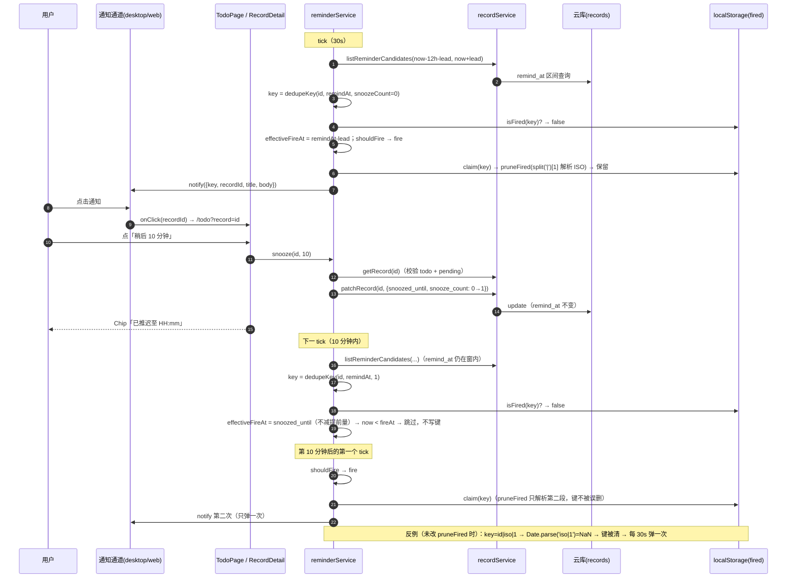
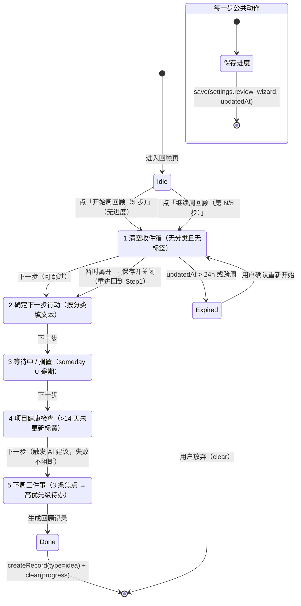
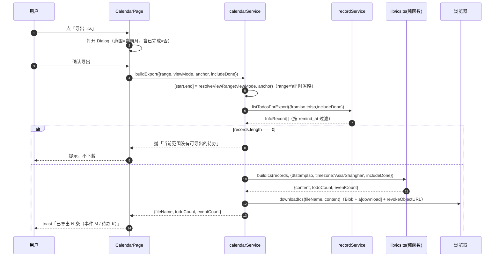
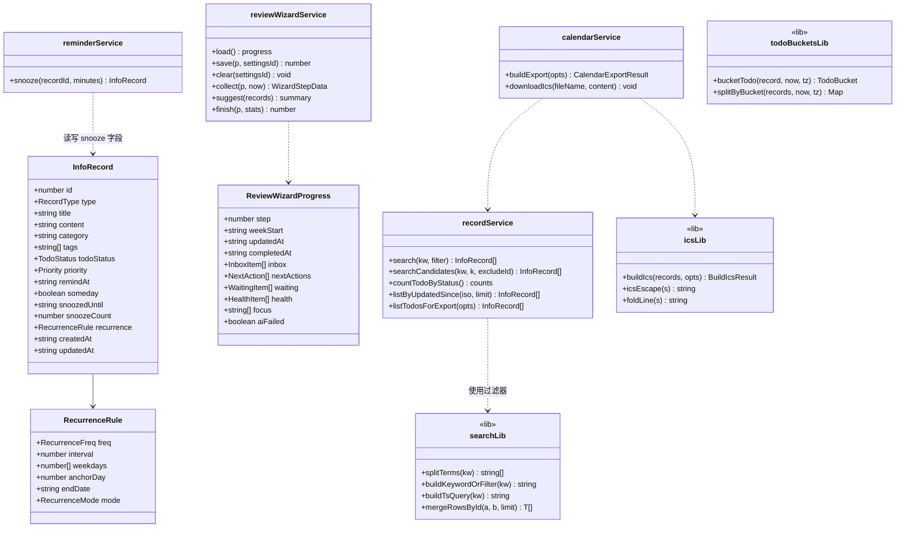
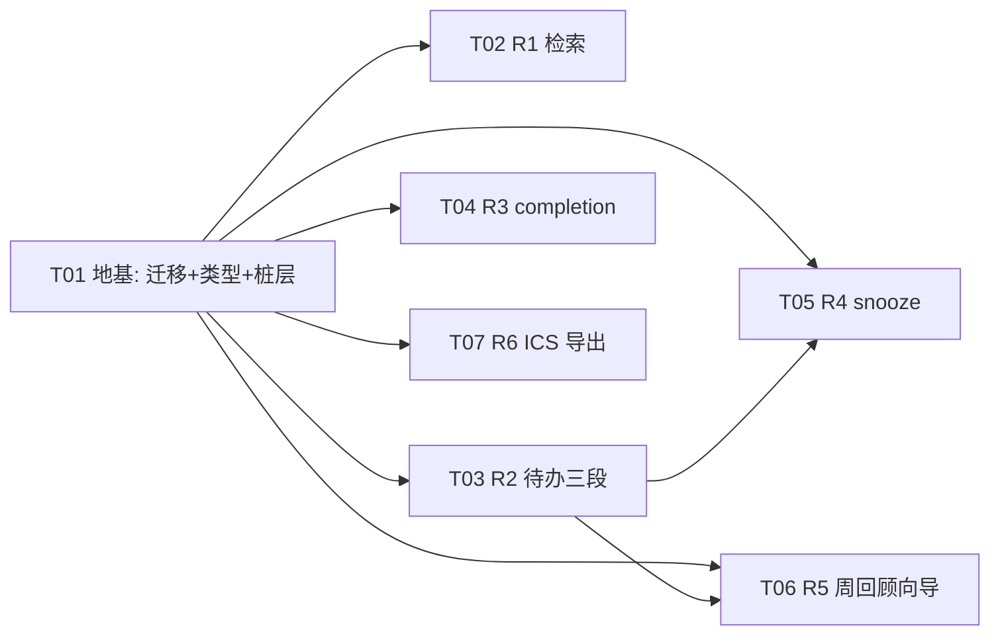

# 个人信息管家 · v2.13 增量设计（DESIGN）

版本基线 **v2.12.2** → 目标 **v2.13.0** ｜ 上游文档：`docs/v2.13/PRD-增量.md`
执行顺序 **R1 → R2 → R3 → R4 → R5 → R6**（PRD §2.1）
本文只做设计：**不改应用源码、不执行 DDL**；配套 DDL 文件 **`docs/v2.13/migration.sql` 已一并产出**（由主理人手工执行）。工程师照此施工即无需回问。

**已确认的环境事实（2026-10-27 实测）**
- `pg_trgm`：`default_version = 1.6`、`installed_version = null` → **可装**。R1 按主案施工（`CREATE EXTENSION IF NOT EXISTS pg_trgm` 作为迁移第一条语句 + 两条 GIN trgm 索引），性能验收维持 PRD 的 1 万条 **p95 < 200ms**，不启用降级档位。
- `btree_gin`（1.3）、`unaccent`（1.1）：均未安装，**本期明确不引入**。因此新增 GIN 索引的键里不含 `owner_id`（复合 GIN 需要 `btree_gin`），命名仍沿用 `records_owner_*` 前缀。
- 既有索引（不改动）：`records_owner_type_idx` / `records_owner_category_idx` / `records_owner_created_idx` / `records_owner_deleted_idx` / `records_tags_gin_idx`，以及 `docs/p0-2026-10/migration.sql` 的 `records_owner_todo_remind_idx` / `records_owner_recurrence_next_idx` / `records_owner_recurrence_parent_idx`。
- `settings` 已有 JSONB 列先例 `float_position`：`review_wizard` 的读写必须走**同一条路径**（`profileService.getSettings()` / `profileService.save()`）。

---

## 0. 与 PRD 的偏离清单（先看，最多 4 条，全部有理由）

| # | PRD 原文 | 本文做法 | 理由 |
| --- | --- | --- | --- |
| D1 | R1：「`search()` / `searchCandidates()` 的 SQL 形态收敛到一个内部函数，两条路径共享」 | 保留「一个过滤器构造函数 + 一个内部执行函数」共享；但 tsvector 叠加改为**独立第二条查询后按 id 合并**，不塞进 `or=(...)` 逻辑树 | `or=(and(or(..),or(..)))` 里再嵌 `wfts(simple)` 的括号会被 PostgREST 逻辑树解析器与分组括号混淆，**语法风险不可控**；`search_tsv=wfts(simple).xxx` 是文档确认的顶层可用写法（`?col=fts(french).term`）。见 §2.1 与 §9-风险 1 |
| D2 | R2：某天 = `someday=true` **或**（`remind_at` 空且 `someday=false`） | 某天 = **仅** `someday=true` | PRD 自身定义与验收 ④「无 `remind_at` 且未标某天 → 出现在即将」互相矛盾；取验收 ④ + 用户故事「不知道什么时候做→标成某天」，否则三段里「今天/即将」会被无日期待办塞满，「某天」失去显式标记语义 |
| D3 | R2：「今天 = `remind_at` 落在本地今日」 | 今天 = `remind_at < 本地明日 00:00`（**含逾期**） | 严格按「今日」判定会让**昨天到期但没完成**的待办在三段里全部消失（违反计数守恒与用户预期）；逾期归「今天」是 GTD 的通行做法 |
| D4 | R5 第 2 步：「为本周期涉及的项目/分类各补一条 `next_action`」 | 第 2 步的 next_action **只写入回顾记录正文，不创建待办** | 本期无「项目」实体，`next_action` 挂靠对象不稳；PRD 只对第 5 步声明了「会新增待办」的副作用，第 2 步静默创建待办会造成「完成回顾后待办莫名变多」。若产品要求可执行化，见 §9-待确认 3 |

---

## 1. 实现方案与关键决策（逐项）

### 1.1 R1 检索升级（P0-1）

**现状问题**：`applyKeyword()` 产出一条 `or(title.ilike.%kw%,content.ilike.%kw%,tags.cs.{kw})`，`%kw%` 前置通配符无法使用 B-Tree，`docs/db-setup.sql` 里没有 trgm/GIN+tsvector，记录量上去即全表扫描；且空格输入被当成「一个含空格的子串」，搜「周报 模板」永远 0 条。

**做法（三层，彼此可独立退化）**

1. **索引层**（DDL，见 §3）：`pg_trgm` + `title`/`content` 两个 GIN，使现有 `ILIKE '%kw%'` 走索引；新增 generated 列 `search_tsv` + GIN，服务英文/多词。
   **环境已实测**：云库 `pg_available_extensions` 里 `pg_trgm` 的 `default_version = 1.6`、`installed_version = null`（未装但**可装**）→ 本项按主案施工，性能验收维持 PRD 的 **1 万条 p95 < 200ms**，不走降级档位（§3.3 仅为「备而不用」）。
2. **匹配层**（`web/src/lib/search.ts`，纯函数，可单测）：
   - `splitTerms(kw)`：按空白切词（`/\s+/u`），去空、去重、保留原序、最多 **5** 个词。
   - **单关键词**（`terms.length === 1`）：`title.ilike.%t%,content.ilike.%t%[,tags.cs.{t}]`
     → 与 v2.12.2 **完全同形**（回归零风险，只多了索引）。
   - **多关键词**（`terms.length ≥ 2`）：每个词产出一个 `or(...)` 组，整体包一层 `and(...)`：
     ```
     or=(and(or(title.ilike.%周报%,content.ilike.%周报%,tags.cs.{周报}),
             or(title.ilike.%模板%,content.ilike.%模板%,tags.cs.{模板})))
     ```
     语义：**每个词都必须在某字段命中**（AND 生效），词内字段之间是 OR。这就是 PRD 验收 ②「搜『周报』『模板』两条都命中 / 搜『周报』『不存在的词』返回 0 条」的实现方式。
     嵌套逻辑树是 PostgREST 文档确认支持的写法（`?and=(grade.gte.90,student.is.true,or(age.gte.14,age.is.null))`，任意深度）。外层 `or()` 只包一层单子节点（等价于 `and`），因为 SDK 只暴露 `.or()`。
3. **叠加层**（tsvector，**仅当关键词含 ≥2 个字母的 ASCII 词时**执行第二条查询）：
   ```ts
   q2.textSearch('search_tsv', tsQuery, { type: 'websearch', config: 'simple' })
   // → 请求参数 search_tsv=wfts(simple).weekly report
   ```
   与 q1 结果**按 id 并集合并**，再 `created_at DESC` 排序、截断到 `LIMITS.search`。
   - 列与查询两侧都是 `simple` 配置 → 词元可比（中文：连续 CJK 只产生**一个**词元，故中文多词 tsvector 基本不命中，符合 PRD 判断，靠 ilike 兜底；英文：不做词干还原，但**逐词 ilike 已覆盖词级 AND**，tsvector 只补「同一词元出现在任意字段」的场景）。
   - 第二条查询**允许失败**（列不存在 / 后端不支持）：`try/catch` 吞掉、只用 q1 → **迁移未执行时应用照常可用**。

**SQL 形态收敛点**（满足 PRD「两条路径共享」）：

```ts
// recordService 内部唯一入口，search() 与 searchCandidates() 都调它
async function runKeywordQuery(
  build: () => PostgrestFilterBuilder,   // 调用方负责 is_deleted/type/category/excludeId
  kw: string,
  limit: number,
): Promise<RecordsRow[]>
```
- q1：`build()` 上链 `.or(buildKeywordOrFilter(kw))`、`order('created_at',{ascending:false})`、`limit`。
- q2：仅当 `buildTsQuery(kw) !== null` 时执行，`build()` 上链 `.textSearch(...)`、同 order/limit。
- 合并：`mergeRowsById(q1Rows, q2Rows, limit)`。

**性能**：`listRecords(keyword)` 与 `search()` 共用同一过滤器；trgm 索引下 `ILIKE '%kw%'` 走 GIN，1 万条 p95 目标 < 200ms。**词长 < 3 的纯 ASCII 词与中文 2 字词可能仍走全表**（trigram 最小 3 字符），受 `LIMITS.search = 50` 保护，接受。

**不做**：`ts_rank` 排序（结果仍 `created_at DESC`）、语义向量检索、`escapeLike` 语义变更（tsvector 路径用自己的清洗函数 `buildTsQuery`，只保留字母/数字/汉字并用空格连接，彻底规避 `& | ! : *` 语法注入）。

---

### 1.2 R2 待办三段视图（P1-3）

**判定函数**（`web/src/lib/todo-buckets.ts`，纯函数，本地日按注入的 `tzOffsetMinutes` 算，默认取运行时）：

```ts
export type TodoBucket = 'today' | 'upcoming' | 'someday'

export function bucketTodo(
  record: Pick<InfoRecord, 'someday' | 'remindAt' | 'priority'>,
  nowMs: number,
  tzOffsetMinutes?: number,
): TodoBucket
```

判定顺序（**互斥且完备**，见 §0-D2/D3）：

| 序 | 条件 | 结果 |
| --- | --- | --- |
| 1 | `someday === true` | `someday` |
| 2 | `remindAt` 为空 且 `priority === 'high'` | `today` |
| 3 | `remindAt` 为空（其余） | `upcoming` |
| 4 | `Date.parse(remindAt) < 本地明日 00:00`（含逾期、含非法字符串按下一条） | `today` |
| 5 | 其余 | `upcoming` |

**计数方案（回应 PRD §7 Q3，结论：前端计数 + 服务端 M）**
- 段内计数 = **已加载集合**的计数（`bucketCounts(loadedPending)`）。
- 页面并行取一次 `recordService.countTodoByStatus()`（2 次 head count）得到 `pending` 总数 M 与 `done` 总数。
- 当 `loadedPending.length < M` 时，在分段下方显示 `已加载 N / 共 M 条，计数仅统计已加载`（`Typography variant="caption"`），点「加载更多」后 N 与计数同步增长。
- **不采用** 3 次服务端 head count：三段划分依赖「本地日边界」与 `someday`/`priority` 组合，PostgREST 无法表达，只能拆成 4~6 次 count 并在前端做容斥，既易漏数又易重复计数（>200 条用户的收益不抵风险）。三段计数之和 = 已加载未完成数，是**恒等式**，可单测。

**交互**：`PageHeader action` 改为 `Stack direction="row" flexWrap`：左 `ToggleButtonGroup size="small" exclusive`（今天 N / 即将 N / 某天 N），右「智能整理」按钮；默认 `today`；三段皆空时给一句空态文案（不渲染空 `List`）。已完成分组保持原样在最下方、不受分段影响。
**`someday` 切换**：卡片操作区新增 `IconButton size="small"`（`BookmarkBorderIcon` / `BookmarkIcon`），点击 → `recordService.updateRecord(id, { someday: !someday })` → 就地刷新，不二次确认。
本条待办只有一段归属（不复制、不重复渲染）。

---

### 1.3 R3 循环「按完成日重复」（P1-4）

**类型**：`RecurrenceRule` 增 `mode?: 'due' | 'completion'`。
**归一**：`normalizeRecurrenceRule()` **仅在 `mode === 'completion'` 时写入该键**；`'due'`/缺省/非法值一律省略键（旧数据 JSONB 不变、diff 噪声最小）。`describeRecurrence()` 在 `completion` 时追加 `（按完成日）`，如「每 2 天（按完成日）」。
**推进**（`computeNext`，唯一改动点）：

```ts
// 原：baseMs = remindMs ?? nowMs
// 新：
const timeOfDay = remindMs - localDayStartMs(remindMs, tz)   // 原 remind_at 的本地时分
const baseMs = rule.mode === 'completion' && remindMs !== null
  ? localDayStartMs(nowMs, tz) + timeOfDay                    // 完成日的同一时分
  : (remindMs ?? nowMs)
```
之后 `advance()` 三条分支**逻辑一行不改**（`weekdays` 优先、`anchorDay` 短月夹取、`endDate` 比较全沿用）。
- `remind_at` 为空 → 走现有「无 remindAt 分支」返回 `nextRemindIso: null`（下一期无提醒时间），UI 在 `RecurrenceField` 中提示「该待办无提醒时间，按完成日重复时不生成提醒」。
- 完成时刻 23:50、原时分 09:00 → 新一期 09:00（因为时分取自 `remind_at`）。

**UI**：`RecurrenceField` 在「间隔」行下方加一行 `RadioGroup row size="small"`：`从到期日算下一期（默认）` / `从完成那天算下一期`，仅当 `rule != null` 时渲染；切换只改 `mode` 键，不改其它键。

---

### 1.4 R4 提醒「稍后」snooze（P1-1）

**键结构（PRD §7 Q7 结论）**：三段式，第三段是 snooze 序号（0 = 原始提醒）。

```ts
export function dedupeKey(recordId: number, remindAt: string, snoozeToken = 0): string
// '123|2026-10-27T09:00:00.000Z|0'  原始提醒
// '123|2026-10-27T09:00:00.000Z|1'  第 1 次 snooze 后重弹
export interface DedupeKeyParts { recordId: number; remindAt: string; snoozeToken: number }
export function parseDedupeKey(key: string): DedupeKeyParts | null
```

**`pruneFired()` 必须同步改（这是最容易踩的坑）**：
```ts
// 旧：sep = key.indexOf('|'); iso = key.slice(sep + 1)  → 拼了 |1 后 Date.parse 得 NaN → 键被清 → 每 30s 弹一次
// 新：
const parts = key.split('|')
if (parts.length < 2) continue
const iso = parts[1]                       // 只认第二段
if (Number.isNaN(Date.parse(iso))) continue
```
旧的两段键（`id|iso`）仍然合法、继续保留（升级不重弹）。**必须补单测**：`pruneFired({[dedupeKey(1, iso, 3)]: now}, now+1s)` 里该键仍在。

**触发时刻**：新增纯函数
```ts
export function effectiveFireAt(
  record: { remindAt?: string | null; snoozedUntil?: string | null },
  leadMinutes: number,
): number
```
`snoozedUntil` 合法 → 直接返回它（**不再减提前量**，「10 分钟后」就是 10 分钟后）；否则 `resolveFireAt(remindAt, lead)`。
`handleCandidate()` 两行改动：`const key = dedupeKey(record.id, record.remindAt, record.snoozeCount ?? 0)`、`const fireAtMs = effectiveFireAt(record, settings.remindLeadMinutes)`。其余（免打扰 defer、12h stale、claim 抢占）**不改**。

**service 方法**：
```ts
export const SNOOZE_OPTIONS = [10, 30, 60] as const          // 分钟
async function snooze(recordId: number, minutes: number): Promise<InfoRecord>
// 1. 校验 minutes ∈ SNOOZE_OPTIONS（否则抛「不支持的推迟时长」）
// 2. getRecord → 必须 type==='todo' && todoStatus==='pending'（否则抛「该记录不是待办」）
// 3. next = (record.snoozeCount ?? 0) + 1；until = new Date(Date.now() + minutes*60_000).toISOString()
// 4. recordService.patchRecord(id, { snoozed_until: until, snooze_count: next })
```
**不改 `remind_at`**（候选窗口按 `remind_at ∈ [now-12h-lead, now+lead]` 拉取，1 小时内 snooze 一定仍在窗内；这也是本期上限 1 小时的原因）。

**状态复位**（放在 service 层，UI 不用记）：
- `recordService.updateTodoStatus(id, 'done')` → 附加 `snoozed_until: null, snooze_count: 0`。
- `recordService.updateRecord()` 收到 `remindAt` → 附加 `snoozed_until: null, snooze_count: 0`（改提醒时间视为新一轮）。
- 循环生成下一期 → 新记录默认 `snooze_count = 0`、`snoozed_until = null`（无需代码）。

**交互（PRD §7 Q6 结论：通知内按钮不做）**：
1. 主路径：点通知 → `/todo?record=<id>`（已有）→ `RecordDetail` 底部操作条 `ButtonGroup size="small" variant="outlined"`：`稍后 10 分钟 / 30 分钟 / 1 小时`、`标记完成`（仅 `type='todo' && todoStatus='pending'` 渲染）。
2. 降级路径（应用内提示条）：`noticeStore` 的 `NoticeItem` 增可选 `actionLabel` / `onAction`，`inapp` 通道发通知时带「稍后 10 分钟」；点击直接 `snooze(recordId, 10)`（一步可达，因为提示条是我们自己的组件）。
   ⚠️ `notification.ts` 不得 `import reminderService`（会形成循环依赖），改为 `setInAppSnoozeHandler(fn)` 由 `reminderService` 在模块初始化时注册。
3. 待办卡片：`snoozedUntil` 有值且 `> now` 时显示 `Chip size="small" variant="outlined" color="info"` 文案 `已推迟至 HH:mm`。

**边界**：系统时间回拨导致 `snoozed_until` 已在过去 → `effectiveFireAt` 返回过去时刻 → `shouldFire` 走 fire 分支立即弹一次（不累积、不循环）。

---

### 1.5 R5 GTD 周回顾向导（P0-2）

**数据来源（全部前端本地判定，AI 只出建议）**

| 步 | 内容 | 数据来源 | 权威判定函数（`web/src/lib/review-wizard.ts`） |
| --- | --- | --- | --- |
| 1 | 清空收件箱 | `recordService.listByRange(weekStart, now)`（与现页同口径） | `pickInbox(records)`：`!category && tags.length === 0` |
| 2 | 确定下一步行动 | 同上 records | `pickCategories(records)`：去重分类清单 |
| 3 | 等待中 / 搁置 | `listRecords({type:'todo', pageSize:200})` + `someday` | `pickWaiting(todos, nowMs)`：`someday===true` ∪ `remindAt < now && pending` |
| 4 | 项目健康 | `recordService.listByUpdatedSince(now-90d, 500)` | `pickStaleCategories(records, nowMs, 14)`：分类内 `max(updated_at) < now-14d` |
| 5 | 下周三件事 | 用户输入 | `FOCUS_COUNT = 3` |

**进度落库**：`settings.review_wizard JSONB`（沿用 `float_position` 先例，**读写同路径**：`profileService.getSettings()` / `profileService.save(id, { review_wizard })`，见 §3.2 末尾）。`UserSettings` 增 `reviewWizard?: ReviewWizardProgress | null`。
- 每次「下一步 / 暂时离开」都 `save()`（写整份 progress，含 `updatedAt`）。
- 读到时若 `now - updatedAt > 24h` 或 `weekStart !== 本周一` → 提示「上次回顾已过期，是否重新开始」（`window.confirm` 式的 `Dialog`，不静默丢弃）。
- 单端假设：不做并发锁（见 §9-风险 5）。

**向导交互**：`Dialog`（`fullScreen` on `<600px`，桌面 `maxWidth="md"`）+ `Stepper alternativeLabel`（5 步）；底部按钮顺序 `暂时离开(text) / 上一步(outlined) / 下一步(contained)`；「下一步」始终可点（允许跳过）；第 5 步按钮变「生成回顾记录」。
**AI**：进入第 5 步时调 `aiService.generateReview(weekRecords)`；失败 → 记录 `aiFailed=true`，`Alert severity="warning"` 一句话「本次未能生成建议」，**不阻断流程、不弹 Dialog**。
**完成落库**：`recordService.createRecord({ type:'note' ... })` —— ⚠️ 现有 `RecordType` 只有 `idea|material|todo`，**没有 `note`**。PRD 写的是 `type='note'`，但 `records.type` 有 CHECK 约束 `CHECK (type IN ('idea','material','todo'))`。**结论：用 `type='idea'` 落库**（回顾记录本质是想法/笔记），标题 `${weekStart 中文日期} 周回顾`，正文含 5 个二级标题（`## 清空收件箱` / `## 下一步行动` / `## 等待中` / `## 项目健康` / `## 下周焦点`）。**不新增 enum 值**（改 CHECK 需 DDL + 影响所有类型分支，收益为零）。
第 5 步的 3 条焦点 → `createRecord({ type:'todo', priority:'high', todoStatus:'pending' })`；完成提示写明「已创建 3 条待办」。完成后 `clear()` 进度并跳回回顾页、打开该条记录。

**幂等**：`finish()` 前后各校验一次 progress 的 `completedAt`；已存在则直接返回该 recordId，不重复落库。同一天走两次向导 = 两次独立流程 = 2 条记录（`completedAt` 在 `clear()` 后归零），符合验收 ⑤。

**两级完成标记（`finish()` 幂等的唯一依据，跨会话成立）**

> - `progress.completedRecordId != null` → 回顾记录**已建**。此时 `completedAt == null` 表示「回顾已建、但焦点待办未走完」（真实触发：`createRecord` 成功但创建待办抛错），重试时**只补待办、不重铸回顾记录**。
> - `progress.completedAt != null` → 整轮走完，`finish()` 为真空操作，直接返回既有 id，**零写入**。
> - 因此「已有完成字段即零写入」**只对 `completedAt` 成立**；对 `completedRecordId` 不成立。二者**不是冗余字段，是两级语义**。
> - 已知取舍：补待办是**整体重补**（若上次 3 条只建了 1 条就失败，重试会再建一遍，最多产生 3 条同名高优先级待办，用户可见可删），换来的是「**回顾记录绝不重复**」。若要逐条精确补齐需引入 per-item 完成标记，不在本期范围。

---

### 1.6 R6 日历导出 .ics（P1-2）

**拆分**：纯函数 `web/src/lib/ics.ts`（无 DOM、无 `Date.now()`，`dtstampIso` 由入参注入 → 可重放单测）+ IO `web/src/services/calendarService.ts`（取数 + 触发下载）。

**映射规则**

| 记录 | 产出 |
| --- | --- |
| 每条 `type='todo'` | 1 个 `VTODO`（`UID:record-{id}@personal-agent`）；`remind_at` 非空带 `DUE`；`todo_status` → `STATUS`（`pending`→`NEEDS-ACTION`，`done`→`COMPLETED` + `COMPLETED:{updated_at}`） |
| 同上且 `remind_at` 非空 | **额外** 1 个 `VEVENT`（`UID:record-{id}-event@personal-agent`，`DTSTART:{remind_at UTC}`，`DURATION:PT30M`） |

`PRIORITY`：high→1 / medium→5 / low→9（RFC 5545 语义，9 为最低）。
**不导出** `RRULE`（不展开循环）、不导出 `idea`/`material`。

**时区（PRD §7 Q5 结论）**：全部用 UTC 形式 `20261027T090000Z` + 头部 `X-WR-TIMEZONE:Asia/Shanghai`，**不内嵌 `VTIMEZONE`**。原因：Google/Outlook 对 `TZID` 未内嵌时行为不一致，UTC 形式兼容性最好、成本最低，且 UTC+8 环境导入后显示与待办页提醒时间一致。

**转义与折行（必须做，否则导入端串行）**：
- `icsEscape`：`\` → `\\`，`;` → `\;`，`,` → `\,`，`\r?\n` → `\n`（字面两字符）。
- `foldLine`：按 **UTF-8 字节**累计，超过 75 字节折行（CRLF + 单空格），续行同样计算（中文 3 字节/字，不能按字符数折）。
- 行尾统一 `\r\n`。

**导出范围**：`范围 = 当前月 / 当前周 / 全部`（默认当前月）+ `包含已完成`（默认否）。
- 「当前月/周」的边界复用视图边界：把 `CalendarPage` 里的 `range` memo 提取为 `web/src/lib/calendar-range.ts` 的 `resolveViewRange(viewMode, anchor)`（纯函数，日历页与导出共用，避免两套口径）。
- 取数：`recordService.listTodosForExport({ fromIso, toIso, includeDone })`，按 **`remind_at`** 过滤（不是 `created_at`）。`全部` → 不传区间，含 `remind_at` 为空的待办（此时只出 `VTODO`、无 `DUE`、无 `VEVENT`）。
- 空集：确认按钮禁用 + 文案「当前范围没有可导出的待办」，不下载空文件。
- 文件名 `personal-agent-YYYYMMDD.ics`（本地日期），用 `Blob` + `URL.createObjectURL` + `<a download>`，用完 `revokeObjectURL`。
- 弹窗内用副标题写明口径：「按**提醒时间**导出；日历页是按创建时间排布的，位置可能不同」。

---

## 2. PRD §7 九条待确认问题 · 逐条结论

| # | 问题 | 结论（不再留「视情况而定」） |
| --- | --- | --- |
| 1 | tsvector 是否保留 | **保留**：建 `search_tsv` 列 + GIN 索引；查询侧仅在「关键词含 ≥2 字母 ASCII 词」时执行第二条 `wfts(simple)` 查询并与 ilike 结果**并集**。中文不依赖 tsvector（连续 CJK 只有一个词元）。列与查询都用 `simple`，避免 config 不匹配 |
| 2 | 云库能否 `CREATE EXTENSION pg_trgm` | **已实测：可装（`pg_trgm` 1.6 在 `pg_available_extensions` 中，`installed_version` 为 null），故按主案执行** `CREATE EXTENSION IF NOT EXISTS pg_trgm` + 两条 GIN trgm 索引；性能验收维持 1 万条 p95 < 200ms。退化档（只靠 `ilike` + 现有索引、p95 < 500ms）保留在 §3.3 作「备而不用」。注意：`CREATE EXTENSION` 需要 migrate 权限，由主理人手工执行，应用层照旧不执行任何 DDL。本期**不引入** `btree_gin` / `unaccent` |
| 3 | R2 三段计数服务端还是前端 | **前端计数 + 服务端 M**：段内计数取已加载集合，`>200` 时显示「已加载 N / 共 M」（M 来自新增 `countTodoByStatus()`）。不做 3 次 head count（本地日边界无法在 PostgREST 表达，需 4~6 次 count 且易重复计数） |
| 4 | R3 新一期时分取谁 | **取原 `remind_at` 的本地时分**；`remind_at` 为空时新一期无提醒时间（`nextRemindIso=null`），并在 `RecurrenceField` 内提示 |
| 5 | R6 时区形式 | **UTC（`...Z`）+ `X-WR-TIMEZONE:Asia/Shanghai`**，不内嵌 `VTIMEZONE` |
| 6 | R4 是否必须通知内按钮 | **不做**（Web `new Notification` 无 `actions`、Windows 无按钮，属平台硬约束）。主路径「点通知 → 详情页操作条」；**例外**：应用内降级提示条带「稍后 10 分钟」（自有组件，一步可达） |
| 7 | dedupeKey 键结构 | **三段式 `id\|iso\|token`**（token = `snooze_count`，0 为原始）。`pruneFired()` 改为 `split('|')` 取第二段解析，兼容旧两段键；补「snooze 键不被 prune」单测 |
| 8 | R5 进度存哪里 | **`settings.review_wizard`（JSONB）**，带 `updatedAt` + `weekStart`；`>24h` 或跨周 → 提示重新开始。不用 localStorage（跨端不一致） |
| 9 | 是否保留 ilike 兜底 | **必须保留**。本期检索 = 「字段内子串（ilike/trgm）+ 词间 AND + tsvector 并集」的混合语义，**不做相关度排序**，结果仍 `created_at DESC`；产品需接受「可能命中不相关但含词的长文」 |

---

## 3. 数据模型与迁移

### 3.1 DDL 草案（落 `docs/v2.13/migration.sql`，同步追加到 `docs/db-setup.sql` 末尾）

```sql
-- =============================================================================
-- 个人信息管家 · v2.13 增量迁移（基线 v2.12.2）
-- 纯增量：只加列/索引/约束；全部可空或有默认值；幂等可重跑；不改既有 RLS 策略。
-- 执行：云库 SQL 控制台整段执行（或按段执行），失败可原样重跑。
--       需要 migrate 权限（CREATE EXTENSION 需要），由主理人手工执行；
--       应用代码【不执行任何 DDL】。
-- 环境事实（2026-10-27 实测）：pg_trgm available 1.6 / installed null（可装）；
--       btree_gin、unaccent 未安装且本期不引入。
-- =============================================================================

-- ---------------------------------------------------------------------------
-- 0) 扩展（第一条语句，必须先于第 4 段的 trgm 索引执行）
--    若云库拒绝 CREATE EXTENSION（权限/策略），见 §3.3「备而不用」：
--    把本段与第 4 段的两条 trgm 索引整段注释掉，其余段仍可正常执行。
-- ---------------------------------------------------------------------------
CREATE EXTENSION IF NOT EXISTS pg_trgm;

-- ---------------------------------------------------------------------------
-- 1) records 增量列
--    someday       R2 「某天」显式标记，历史数据 false（= 今天/即将，与现状一致）
--    snoozed_until R4 推迟到期时刻，空 = 未推迟
--    snooze_count  R4 去重键序号（= dedupeKey 第三段），跨重启不丢
--    search_tsv    R1 generated 列，PG 自动为存量行计算，无需回填、无需写入代码
-- ---------------------------------------------------------------------------
ALTER TABLE public.records
  ADD COLUMN IF NOT EXISTS someday       BOOLEAN     NOT NULL DEFAULT false,
  ADD COLUMN IF NOT EXISTS snoozed_until TIMESTAMPTZ,
  ADD COLUMN IF NOT EXISTS snooze_count  INT         NOT NULL DEFAULT 0;

ALTER TABLE public.records
  ADD COLUMN IF NOT EXISTS search_tsv tsvector
    GENERATED ALWAYS AS (
      to_tsvector('simple', coalesce(title, '') || ' ' || coalesce(content, ''))
    ) STORED;

COMMENT ON COLUMN public.records.someday IS 'v2.13 R2 待办「某天」显式标记（true 时归入某天段，不再出现在今天/即将）';
COMMENT ON COLUMN public.records.snoozed_until IS 'v2.13 R4 稍后提醒的到期时刻（UTC），空表示未推迟；不改 remind_at';
COMMENT ON COLUMN public.records.snooze_count IS 'v2.13 R4 已 snooze 次数，用作去重键第三段；完成/改提醒时间时由应用层复位为 0';
COMMENT ON COLUMN public.records.search_tsv IS 'v2.13 R1 检索用 generated tsvector（simple 配置，title + content）';
COMMENT ON COLUMN public.records.recurrence IS 'P0-B 循环规则 {freq:daily|weekly|monthly,interval:1..99,weekdays:number[],anchorDay?:1..31,endDate:YYYY-MM-DD|null,mode?:due|completion}';

-- ---------------------------------------------------------------------------
-- 2) settings 增量列
-- ---------------------------------------------------------------------------
ALTER TABLE public.settings
  ADD COLUMN IF NOT EXISTS review_wizard JSONB;

COMMENT ON COLUMN public.settings.review_wizard IS 'v2.13 R5 周回顾向导断点续进度（ReviewWizardProgress），空表示无进行中回顾';

-- ---------------------------------------------------------------------------
-- 3) 约束（幂等：PG 不支持 ADD CONSTRAINT IF NOT EXISTS，用 catalog 判重）
-- ---------------------------------------------------------------------------
DO $$
BEGIN
  IF NOT EXISTS (
    SELECT 1 FROM pg_constraint
     WHERE conname = 'records_snooze_count_chk' AND conrelid = 'public.records'::regclass
  ) THEN
    ALTER TABLE public.records ADD CONSTRAINT records_snooze_count_chk CHECK (snooze_count >= 0);
  END IF;
END $$;

-- ---------------------------------------------------------------------------
-- 4) 索引
--    trgm：让现有 ILIKE '%kw%' 走 GIN（R1 性能主路径）
--    tsv ：英文/多词叠加路径
--    命名沿用既有 records_owner_* 风格（与 records_owner_created_idx 等一致）；
--    但键里【不含 owner_id】：GIN 复合需要 btree_gin，本期不引入。
--    owner 维度的过滤由 RLS 策略作为过滤条件施加，单账号数据量下选择率足够。
-- ---------------------------------------------------------------------------
CREATE INDEX IF NOT EXISTS records_owner_title_trgm_idx
  ON public.records USING GIN (title gin_trgm_ops);
CREATE INDEX IF NOT EXISTS records_owner_content_trgm_idx
  ON public.records USING GIN (content gin_trgm_ops);
CREATE INDEX IF NOT EXISTS records_owner_search_tsv_idx
  ON public.records USING GIN (search_tsv);

-- ---------------------------------------------------------------------------
-- 5) 自检（执行后人工核对：期望 4 / 1 / 3 / 1）
-- ---------------------------------------------------------------------------
-- SELECT count(*) FROM information_schema.columns
--  WHERE table_schema='public' AND table_name='records'
--    AND column_name IN ('someday','snoozed_until','snooze_count','search_tsv');      -- 期望 4
-- SELECT count(*) FROM information_schema.columns
--  WHERE table_schema='public' AND table_name='settings' AND column_name='review_wizard'; -- 期望 1
-- SELECT indexname FROM pg_indexes WHERE schemaname='public'
--   AND indexname IN ('records_owner_title_trgm_idx','records_owner_content_trgm_idx',
--                     'records_owner_search_tsv_idx');                                 -- 期望 3
-- SELECT extname, extversion FROM pg_extension WHERE extname='pg_trgm';                -- 期望 1 行，1.6
-- SELECT policyname FROM pg_policies WHERE schemaname='public'
--   AND tablename IN ('records','settings');                                            -- 期望各 4 条，未变

-- ---------------------------------------------------------------------------
-- 6) 回滚（默认注释；一般只需回退应用代码）
-- ---------------------------------------------------------------------------
-- DROP INDEX IF EXISTS public.records_owner_title_trgm_idx;
-- DROP INDEX IF EXISTS public.records_owner_content_trgm_idx;
-- DROP INDEX IF EXISTS public.records_owner_search_tsv_idx;
-- ALTER TABLE public.records
--   DROP CONSTRAINT IF EXISTS records_snooze_count_chk,
--   DROP COLUMN IF EXISTS someday,
--   DROP COLUMN IF EXISTS snoozed_until,
--   DROP COLUMN IF EXISTS snooze_count,
--   DROP COLUMN IF EXISTS search_tsv;
-- ALTER TABLE public.settings DROP COLUMN IF EXISTS review_wizard;
-- DROP EXTENSION IF EXISTS pg_trgm;
```

### 3.2 逐列说明

| 对象 | 可空 | 默认 | 需回填 | RLS 影响 | 幂等写法 |
| --- | --- | --- | --- | --- | --- |
| `records.someday` | NOT NULL | `false` | 否（`false` 即旧行为） | 无（策略按 `owner_id`，不含字段） | `ADD COLUMN IF NOT EXISTS` |
| `records.snoozed_until` | 可空 | `NULL` | 否（空 = 未推迟） | 无 | 同上 |
| `records.snooze_count` | NOT NULL | `0` | 否（0 = 从未 snooze） | 无 | 同上 |
| `records.search_tsv` | 可空（generated） | 自动计算 | **否**（PG 建列时对存量行计算一次，不产生 UPDATE 风暴） | 无（仅 `select *` 可读，写被 PG 拒绝） | `ADD COLUMN IF NOT EXISTS ... GENERATED ... STORED` |
| `records_owner_title_trgm_idx` / `records_owner_content_trgm_idx` | — | — | — | 无 | `CREATE INDEX IF NOT EXISTS` |
| `records_owner_search_tsv_idx` | — | — | — | 无 | 同上 |
| `pg_trgm` 扩展 | — | — | — | 无 | `CREATE EXTENSION IF NOT EXISTS`（**migrate 权限，第一条语句**；已实测可装 1.6） |
| `settings.review_wizard` | 可空 | `NULL` | 否 | 无 | `ADD COLUMN IF NOT EXISTS` |
| `recurrence.mode` | JSONB 内键 | 缺省视为 `due` | 否 | 无 | **无 DDL**，仅 `normalizeRecurrenceRule()` 归一 + 列注释 |

**索引命名说明**：新增三条索引沿用既有 `records_owner_*` 前缀（与 `records_owner_type_idx` / `records_owner_created_idx` / `records_owner_todo_remind_idx` 一致），但**索引键里不含 `owner_id`** —— GIN 复合键需要 `btree_gin` 扩展，本期**明确不引入**；owner 维度由 RLS 策略作为过滤条件施加，单账号数据量下选择率足够。`records_tags_gin_idx`（既有，GIN on tags）保持不变。

**`settings` 读写口径**：`review_wizard` 的读写必须与既有 `float_position` 走**同一条路径** —— `profileService.getSettings()` 读整行、`profileService.save(settingsId, { review_wizard })` 写；**禁止**在 `reviewWizardService` 里另建 `cloud.database.from('settings')` 直连（会绕过 `save()` 的「有 id 则 update、无则 insert」逻辑，容易撞 `owner_id` 唯一约束 23505）。

### 3.3 退化分支 ——「备而不用」（仅当云库拒绝 `CREATE EXTENSION` 时启用）

> 现状：`pg_trgm` 已在 `pg_available_extensions` 中确认可装（1.6），**本分支当前不启用**，仅作为执行迁移时的兜底预案保留在文件里。触发条件只有两个：`CREATE EXTENSION` 报权限/策略错误；或托管层禁用了该扩展。

1. 执行 `docs/v2.13/migration.sql` 时注释掉第 0 段（`CREATE EXTENSION`）与第 4 段两条 trgm 索引，**其余段照常**（文件已按段组织，可逐段执行）。
2. 应用层**零改动**：查询形态不变（`ilike` 仍是中文主力路径，逐词 `ilike` 的 AND 语义不依赖索引），只是少了加速。
3. 验收降档：1 万条种子数据 `search()` p95 < **500ms**；PRD 的 p95 < 200ms 不适用，需在 `docs/版本说明.md` 与发布说明显式写明「本环境未启用三元组索引（pg_trgm），大记录量下检索较慢」。
4. tsvector 段**不退化**（`to_tsvector` 是内置函数，不依赖扩展），因此英文多词叠加路径仍然可用。
5. **不允许**为了省事引入 `btree_gin` 或 `unaccent` 来绕开限制（本期零新增扩展承诺）。

### 3.4 类型同步（三处 + 一处桌面注释）

| 位置 | 改动 |
| --- | --- |
| `shared/types/domain.ts` | `InfoRecord` += `someday: boolean` / `snoozedUntil?: string \| null` / `snoozeCount: number`；`RecordCreateInput`/`RecordUpdateInput` += 同名字段（可选）；`RecurrenceRule` += `mode?: 'due' \| 'completion'`；`UserSettings` += `reviewWizard?: ReviewWizardProgress \| null`；新增 `ReviewWizardProgress` 等类型 |
| `web/src/lib/database.types.ts` | `RecordsRow` += `someday: boolean` / `snoozed_until: string \| null` / `snooze_count: number` / `search_tsv?: string \| null`（`?` 为兼容迁移未执行）；`SettingsRow` += `review_wizard: unknown` |
| `web/src/services/recordService.ts` | `mapRecord()` 读新列（**全部带默认值**：`row.someday ?? false`、`row.snooze_count ?? 0`、`row.snoozed_until ?? null`）；`toSnake()` 写新列 |
| `desktop/src/shared/ipc-contract.ts` | 第 255 行注释 `记录id\|remind_at` → `记录id\|remind_at\|snooze序号`（**仅注释**，`key.length > 400` 上限不受影响） |

> ⚠️ 任务描述里写的 `web/src/types/database.types.ts` 实际路径是 **`web/src/lib/database.types.ts`**（`web/src/types/` 下只有 `env.d.ts`）。

---

## 4. 文件清单

### 新增

| 路径 | 职责 |
| --- | --- |
| `docs/v2.13/migration.sql` | v2.13 增量迁移 DDL（**已产出**：幂等分段；首条 `CREATE EXTENSION IF NOT EXISTS pg_trgm`；含「备而不用」的退化预案注释） |
| `docs/v2.13/DESIGN-增量.md` | 本文 |
| `web/src/lib/search.ts` | 关键词切词/转义/过滤器构造/tsquery 清洗（纯函数） |
| `web/src/lib/todo-buckets.ts` | 待办三段判定与计数（纯函数） |
| `web/src/lib/ics.ts` | iCalendar 文本构造：`buildIcs` / `icsEscape` / `foldLine` / `toIcsUtc`（纯函数） |
| `web/src/lib/calendar-range.ts` | 月/周视图时间边界 `resolveViewRange`（日历页与导出共用） |
| `web/src/lib/review-wizard.ts` | 向导 5 步规则、进度归一、正文构造（纯函数） |
| `web/src/services/calendarService.ts` | 导出取数 + 下载触发（IO） |
| `web/src/services/reviewWizardService.ts` | 向导进度读写（`settings.review_wizard`）+ 各步数据收集 + 完成落库 |
| `web/src/components/ReviewWizard.tsx` | 5 步向导 `Dialog`（`Stepper` + 单步内容 + 底部按钮） |
| `web/src/components/SnoozeActions.tsx` | 「稍后 10/30/60 分钟 + 标记完成」操作条（详情页复用） |
| `qa/v213-foundation.test.ts` | 地基：`mapRecord` 缺列默认值、`toSnake` 新字段、迁移未执行时的兼容 |
| `qa/v213-search.test.ts` | `splitTerms` / `buildKeywordOrFilter` / `buildTsQuery` / 合并去重 |
| `qa/v213-todo-buckets.test.ts` | 三段互斥完备、逾期归今天、计数守恒 |
| `qa/v213-reminder-snooze.test.ts` | `dedupeKey` 三段、`parseDedupeKey`、`pruneFired` 不误删、`effectiveFireAt`、`snooze()` 链路 |
| `qa/v213-ics.test.ts` | UID 稳定、UTC 时间、转义、折行、空集、状态映射 |
| `qa/v213-review-wizard.test.ts` | 收件箱选择、等待中并集、14 天标黄、进度归一/过期、正文 5 小节 |

### 修改

| 路径 | 职责 |
| --- | --- |
| `docs/db-setup.sql` | 末尾追加「增量迁移（v2.13）」段（与 migration.sql 同内容） |
| `docs/版本说明.md` | 新增 2.13.0 条目（6 项特性 + 退化说明） |
| `shared/types/domain.ts` | 领域类型（见 §3.4） |
| `web/src/lib/database.types.ts` | `RecordsRow` / `SettingsRow` |
| `web/src/lib/recurrence.ts` | `mode` 归一 + `computeNext` 基准日分支 + `describeRecurrence` 文案 |
| `web/src/lib/reminder-schedule.ts` | `dedupeKey` 三段 / `parseDedupeKey` / `pruneFired` 解析 / `effectiveFireAt` |
| `web/src/services/recordService.ts` | 检索收敛 `runKeywordQuery`、`countTodoByStatus`、`listByUpdatedSince`、`listTodosForExport`、`mapRecord`/`toSnake` 新字段、完成/改提醒时复位 snooze |
| `web/src/services/reminderService.ts` | `snooze()` + `effectiveFireAt` + 三段键 + 注册 inapp snooze handler |
| `web/src/services/notification.ts` | inapp 通道带「稍后 10 分钟」动作（`setInAppSnoozeHandler`，避免循环依赖） |
| `web/src/store/noticeStore.ts` | `NoticeItem` 增 `actionLabel?` / `onAction?`（向后兼容） |
| `web/src/components/NoticeHost.tsx` | 渲染提示条动作按钮（右对齐） |
| `web/src/components/RecordDetail.tsx` | 底部 `SnoozeActions`（仅 pending 待办） |
| `web/src/components/RecurrenceField.tsx` | 「按时日/按完成日」单选 + 无提醒时间提示 |
| `web/src/pages/TodoPage.tsx` | 三段 `ToggleButtonGroup` + 计数 + `已加载 N / 共 M` + 「某天」按钮 + 「已推迟至」Chip |
| `web/src/pages/ReviewPage.tsx` | 向导入口按钮（含「继续（第 N/5 步）」）+ 完成后展示记录 |
| `web/src/pages/CalendarPage.tsx` | 「导出 .ics」按钮 + 导出 `Dialog` + 改用 `resolveViewRange` |
| `qa/mocks/cloud.ts` | `QueryBuilder` 增 `textSearch` / `is` / `filter` / `lt`；`count` 支持（head count 断言） |
| `qa/run-tests.mjs` | 注册 6 个新测试文件 |
| `qa/recurrence.test.ts` | 追加 `completion` 模式用例 ≥5 条 |
| `package.json` / `web/package.json` / `desktop/package.json` | 仅 `version` → `2.13.0`（**零新增依赖**） |

---

## 5. 接口与数据结构

### 5.1 领域类型（`shared/types/domain.ts`）

```ts
export type RecurrenceMode = 'due' | 'completion'

export interface RecurrenceRule {
  freq: RecurrenceFreq
  interval: number
  weekdays?: number[]
  anchorDay?: number | null
  endDate?: string | null
  /** v2.13：下一期基准日。缺省 = 'due'（旧行为）；'completion' = 以完成日为基准。 */
  mode?: RecurrenceMode
}

export interface InfoRecord {
  // …既有字段…
  /** v2.13 R2 「某天」显式标记（默认 false）。 */
  someday: boolean
  /** v2.13 R4 稍后提醒到期时刻（ISO UTC），空 = 未推迟。 */
  snoozedUntil?: string | null
  /** v2.13 R4 已 snooze 次数（去重键第三段）。 */
  snoozeCount: number
}

// ── R2 ──
export type TodoBucket = 'today' | 'upcoming' | 'someday'
export interface TodoBucketCounts { today: number; upcoming: number; someday: number; total: number }

// ── R5 ──
export type ReviewWizardStep = 1 | 2 | 3 | 4 | 5

export interface ReviewWizardProgress {
  version: 1
  /** 当前步（1..5）。 */
  step: ReviewWizardStep
  /** 本周一本地日 'YYYY-MM-DD'（跨周即失效）。 */
  weekStart: string
  startedAt: string
  updatedAt: string
  /** 完成时间；非空表示已落库，用于幂等。 */
  completedAt?: string | null
  /** 落库后的回顾记录 id。 */
  completedRecordId?: number | null
  inbox: Array<{ recordId: number; decision: 'assign' | 'archive' | 'skip'; category?: string | null }>
  nextActions: Array<{ category: string; text: string }>
  waiting: Array<{ recordId: number; decision: 'keep' | 'delete' | 'skip' }>
  health: Array<{ category: string; acknowledged: boolean }>
  focus: string[]
  aiFailed?: boolean
}

// ── R6 ──
export type IcsRange = 'month' | 'week' | 'all'
```

### 5.2 纯函数签名

```ts
// web/src/lib/search.ts
export const MAX_TERMS = 5
export function splitTerms(keyword: string): string[]
export function escapeLike(value: string): string
export function escapeTagTerm(term: string): string | null          // 含 {}",\ 时返回 null（跳过 tags 命中）
export function buildKeywordOrFilter(keyword: string): string | null // 返回 or=() 内的内容；空关键词 null
export function buildTsQuery(keyword: string): string | null         // 仅 ASCII 词场景返回清洗后的查询串
export function mergeRowsById<T extends { id: number; created_at: string }>(a: T[], b: T[], limit: number): T[]

// web/src/lib/todo-buckets.ts
export function bucketTodo(
  record: Pick<InfoRecord, 'someday' | 'remindAt' | 'priority'>,
  nowMs: number,
  tzOffsetMinutes?: number,
): TodoBucket
export function bucketCounts(records: InfoRecord[], nowMs: number, tzOffsetMinutes?: number): TodoBucketCounts
export function splitByBucket(records: InfoRecord[], nowMs: number, tzOffsetMinutes?: number): Record<TodoBucket, InfoRecord[]>

// web/src/lib/reminder-schedule.ts
export function dedupeKey(recordId: number, remindAt: string, snoozeToken?: number): string
export function parseDedupeKey(key: string): DedupeKeyParts | null
export function pruneFired(store: FiredStore, nowMs: number, keepMs?: number): FiredStore
export function effectiveFireAt(
  record: { remindAt?: string | null; snoozedUntil?: string | null },
  leadMinutes: number,
): number

// web/src/lib/recurrence.ts
export function computeNext(rule: RecurrenceRule, input: ComputeNextInput): ComputeNextResult  // 内部按 mode 选基准
export function normalizeMode(value: unknown): RecurrenceMode | undefined                        // 仅 'completion' 返回
export function describeRecurrence(rule: RecurrenceRule | null | undefined, remindAt?: string | null): string

// web/src/lib/calendar-range.ts
export function resolveViewRange(viewMode: 'month' | 'week', anchor: Date): [Date, Date]

// web/src/lib/ics.ts
export interface IcsSource {
  id: number
  title: string
  content?: string | null
  category?: string | null
  priority?: 'high' | 'medium' | 'low' | null
  todoStatus?: 'pending' | 'done' | null
  remindAt?: string | null
  updatedAt?: string | null
}
export interface BuildIcsOptions {
  /** DTSTAMP，注入以便单测可重放（函数内不得读 Date.now）。 */
  dtstampIso: string
  timezone?: string            // 默认 'Asia/Shanghai'
  eventDurationMinutes?: number // 默认 30
  includeDone?: boolean        // 默认 false
}
export interface BuildIcsResult { content: string; todoCount: number; eventCount: number }
export function buildIcs(records: IcsSource[], opts: BuildIcsOptions): BuildIcsResult
export function icsEscape(value: string): string
export function foldLine(line: string): string
export function toIcsUtc(iso: string | null | undefined): string | null
export function icsFileName(nowMs: number): string   // personal-agent-YYYYMMDD.ics

// web/src/lib/review-wizard.ts
export const FOCUS_COUNT = 3
export const STALE_DAYS = 14
export const PROGRESS_TTL_MS = 24 * 60 * 60 * 1000
export function isoWeekStart(nowMs: number, tzOffsetMinutes?: number): string   // 'YYYY-MM-DD'（周一）
export function emptyProgress(nowMs: number): ReviewWizardProgress
export function normalizeProgress(raw: unknown): ReviewWizardProgress | null
export function isProgressExpired(p: ReviewWizardProgress, nowMs: number): boolean
export function pickInbox(records: InfoRecord[]): InfoRecord[]
export function pickCategories(records: InfoRecord[]): string[]
export function pickWaiting(todos: InfoRecord[], nowMs: number): InfoRecord[]
export function pickStaleCategories(
  records: Array<Pick<InfoRecord, 'category' | 'updatedAt'>>,
  nowMs: number,
  days?: number,
): string[]
export function buildReviewNoteBody(p: ReviewWizardProgress, stats: {
  inbox: number; waiting: number; stale: string[]; aiSummary?: string | null; aiFailed?: boolean
}): string
```

### 5.3 服务方法签名

```ts
// web/src/services/recordService.ts（新增/修改）
export const recordService = {
  // …既有…
  search(keyword: string, filter?: { type?: RecordType; category?: string }): Promise<InfoRecord[]>
  searchCandidates(keyword: string, k?: number, excludeId?: number): Promise<InfoRecord[]>
  /** R2：待办未完成/已完成总数（2 次 head count）。 */
  countTodoByStatus(): Promise<{ pending: number; done: number }>
  /** R5 第 4 步：取 updated_at >= sinceIso 的记录（用于 14 天健康判定）。 */
  listByUpdatedSince(sinceIso: string, limit?: number): Promise<InfoRecord[]>
  /** R6：按 remind_at 区间取待办（导出用）；不传区间 = 全部（含 remind_at 为空）。 */
  listTodosForExport(opts: { fromIso?: string; toIso?: string; includeDone: boolean; limit?: number }): Promise<InfoRecord[]>
}

// web/src/services/reminderService.ts
export const SNOOZE_OPTIONS: readonly number[]           // [10, 30, 60]
export function snooze(recordId: number, minutes: number): Promise<InfoRecord>
export const reminderService = { /* …既有…, */ snooze }

// web/src/services/notification.ts
export function setInAppSnoozeHandler(fn: ((recordId: number) => void) | null): void

// web/src/services/calendarService.ts
export interface CalendarExportOptions {
  range: IcsRange
  viewMode: 'month' | 'week'
  anchor: Date
  includeDone: boolean
}
export interface CalendarExportResult { content: string; fileName: string; todoCount: number; eventCount: number; recordCount: number }
export async function buildExport(opts: CalendarExportOptions): Promise<CalendarExportResult>
export function downloadIcs(fileName: string, content: string): void
export const calendarService = { buildExport, downloadIcs }

// web/src/services/reviewWizardService.ts
export interface WizardStepData {
  inbox: InfoRecord[]
  categories: string[]
  waiting: InfoRecord[]
  staleCategories: string[]
  weekRecords: InfoRecord[]
}
export const reviewWizardService = {
  load(): Promise<{ progress: ReviewWizardProgress | null; settingsId: number | null }>
  save(progress: ReviewWizardProgress, settingsId: number | null): Promise<number | null>
  clear(settingsId: number | null): Promise<void>
  collect(progress: ReviewWizardProgress, nowMs?: number): Promise<WizardStepData>
  suggest(weekRecords: InfoRecord[]): Promise<{ summary: string | null; failed: boolean }>
  finish(progress: ReviewWizardProgress, stats: { inbox: number; waiting: number; stale: string[]; aiSummary: string | null; aiFailed: boolean }): Promise<number>
}
```

---

## 6. 调用流程

### 6.1 R4 snooze 全链路（含 `pruneFired` 校验）



### 6.2 R5 周回顾向导 5 步状态机



### 6.3 R6 ICS 导出



### 6.4 R1 检索合并流程

```mermaid
flowchart TD
  A[用户输入 keyword] --> B{trim 后为空?}
  B -- 是 --> Z[返回原列表分页，不加过滤]
  B -- 否 --> C[splitTerms：最多 5 词]
  C --> D{词数 == 1?}
  D -- 是 --> E["or=(title.ilike.%t%,content.ilike.%t%[,tags.cs.{t}])"]
  D -- 否 --> F["or=(and(or(..t1..),or(..t2..),…))<br/>词间 AND / 字段间 OR"]
  E --> G[q1: order created_at DESC + limit]
  F --> G
  C --> H{"含 ≥2 字母 ASCII 词?"}
  H -- 否 --> I[只用 q1]
  H -- 是 --> J["q2: search_tsv=wfts(simple).term…<br/>try/catch，列缺失则忽略"]
  J --> K[mergeRowsById(q1,q2,limit)]
  G --> I
  I --> L[返回 InfoRecord[]]
  K --> L
```

### 6.5 类图（新增/改动部分）



---

## 7. 任务列表（严格按 R1→R2→R3→R4→R5→R6）

> 说明：PRD 要求「执行顺序即验收顺序」，每项都是可独立验证的增量，因此按「地基 + 每 R 一个任务」拆为 7 个（多于默认 5 个上限，因为每项都有独立 QA 门禁，合并会破坏顺序验收）；每个任务均 ≥3 文件、无长链依赖（除地基外互不依赖）。

### T01 · 地基：迁移 + 三处类型同步 + 桩层（P0）

- **文件**：`docs/v2.13/migration.sql`（**已由架构师产出，本任务只需核对并同步到 `docs/db-setup.sql` 末尾段**）、`docs/db-setup.sql`（追加段）、`shared/types/domain.ts`、`web/src/lib/database.types.ts`、`web/src/services/recordService.ts`（`mapRecord`/`toSnake` 新字段 + 复位逻辑的字段位）、`desktop/src/shared/ipc-contract.ts`（注释）、`qa/mocks/cloud.ts`（`textSearch`/`is`/`lt`/`filter`/`count`）、`qa/v213-foundation.test.ts`（新）、`qa/run-tests.mjs`（注册）
- **依赖**：无
- **要点**：`mapRecord` 对缺列全部回落默认值（迁移未执行也能跑）；不做任何查询条件变更。迁移文件**首句为 `CREATE EXTENSION IF NOT EXISTS pg_trgm`**（已实测可装 1.6），索引名沿用 `records_owner_*` 前缀（`records_owner_title_trgm_idx` / `records_owner_content_trgm_idx` / `records_owner_search_tsv_idx`，键内含 owner_id 需 btree_gin，故不含）；「备而不用」的退化预案只写成注释段，不写进代码分支。

### T02 · R1 检索升级（P0）

- **文件**：`web/src/lib/search.ts`（新）、`web/src/services/recordService.ts`（`runKeywordQuery` + `applyKeyword` 替换）、`qa/v213-search.test.ts`（新）、`qa/run-tests.mjs`
- **依赖**：T01
- **要点**：单关键词形态与旧版同形；多关键词走 `and(or(..))`；tsvector 第二条查询 try/catch；`search()`/`searchCandidates()`/`listRecords(keyword)` 三处共用。
- **自检**：`qa/recordService-crud.test.ts`、`qa/p0-c-domain-resolution-regression.test.ts` 全绿；迁移后 1 万条种子 p95 < 200ms。

### T03 · R2 待办三段视图（P1）

- **文件**：`web/src/lib/todo-buckets.ts`（新）、`web/src/services/recordService.ts`（`countTodoByStatus`）、`web/src/pages/TodoPage.tsx`、`qa/v213-todo-buckets.test.ts`（新）、`qa/run-tests.mjs`
- **依赖**：T01
- **自检**：三段计数守恒；标「某天」互斥迁移；已完成分组回归。

### T04 · R3 循环 completion 模式（P1）

- **文件**：`shared/types/domain.ts`（`mode`）、`web/src/lib/recurrence.ts`、`web/src/components/RecurrenceField.tsx`、`qa/recurrence.test.ts`（追加 ≥5 用例）、`docs/db-setup.sql`（`recurrence` 列注释已在 T01 同段，无需重复）
- **依赖**：T01
- **自检**：`qa/recurrence.test.ts`、`qa/recurrence-service.test.ts`、`qa/p0-b-*.test.ts` 全绿（旧数据无 `mode` → `due`）。

### T05 · R4 提醒 snooze（P1）

- **文件**：`web/src/lib/reminder-schedule.ts`、`web/src/services/reminderService.ts`、`web/src/services/notification.ts`、`web/src/store/noticeStore.ts`、`web/src/components/NoticeHost.tsx`、`web/src/components/RecordDetail.tsx`、`web/src/components/SnoozeActions.tsx`（新）、`web/src/pages/TodoPage.tsx`（已推迟 Chip）、`qa/v213-reminder-snooze.test.ts`（新）、`qa/run-tests.mjs`
- **依赖**：T01、T03（TodoPage 同文件，避免冲突）
- **自检**：`pruneFired` 不误删三段键；连续 snooze 3 次总弹次 = 4；跨重启行为；`qa/p0-a-*.test.ts` 全绿。

### T06 · R5 GTD 周回顾向导（P0）

- **文件**：`shared/types/domain.ts`（`ReviewWizardProgress`）、`web/src/lib/review-wizard.ts`（新）、`web/src/services/reviewWizardService.ts`（新）、`web/src/services/recordService.ts`（`listByUpdatedSince`）、`web/src/components/ReviewWizard.tsx`（新）、`web/src/pages/ReviewPage.tsx`、`qa/v213-review-wizard.test.ts`（新）、`qa/run-tests.mjs`
- **依赖**：T01、T03（第 3 步读 `someday`）
- **要点**：`review_wizard` 的读写只经 `profileService.getSettings()` / `profileService.save(id, { review_wizard })`（与 `float_position` 同路径），`reviewWizardService` 内不得直连 `settings` 表。
- **自检**：5 步走完落 1 条记录、正文含 5 小节；断点续到第 3 步；断网不中断。

### T07 · R6 日历 ICS 导出 + 版本收尾（P1）

- **文件**：`web/src/lib/ics.ts`（新）、`web/src/lib/calendar-range.ts`（新）、`web/src/services/calendarService.ts`（新）、`web/src/services/recordService.ts`（`listTodosForExport`）、`web/src/pages/CalendarPage.tsx`、`qa/v213-ics.test.ts`（新）、`qa/run-tests.mjs`、`docs/版本说明.md`、`package.json` / `web/package.json` / `desktop/package.json`（version）
- **依赖**：T01
- **自检**：UID 二次导出一致；UTC 形式 + `X-WR-TIMEZONE`；`,`/`;`/`\`/换行转义与 75 字节折行；空集不下载；Google/Outlook 各导入一次（人工，截图存 `docs/v2.13/`）。

### 任务依赖图



---

## 8. 共享知识（跨文件约定，工程师照做）

1. **命名**：领域层 camelCase（`someday` / `snoozedUntil` / `snoozeCount` / `reviewWizard`），数据库 snake_case（`someday` / `snoozed_until` / `snooze_count` / `review_wizard`）；映射只在 `mapRecord` / `toSnake` 两处发生，**别处不得直接摸 `Record<string, unknown>` 拼列名**。
2. **时间**：库里一律 UTC ISO；展示用 `toLocaleString('zh-CN')`；**本地日**判定统一用「注入 `tzOffsetMinutes`（东八区 480）+ 平移轴」写法（照抄 `lib/recurrence.ts` / `lib/reminder-schedule.ts` 现有范式），禁止 `toISOString().slice(0,10)` 当本地日。
3. **迁移未执行也必须能跑**：所有读新列的地方 `?? 默认值`；所有依赖新列/新语法的查询都要 `try/catch` 或参数可选（R1 的 tsvector 第二条查询是范例）。新代码不得在启动时探测/执行 DDL。
4. **纯函数下沉**：凡是不碰网络/DOM 的逻辑（判定、过滤、文本拼装、进度归一）一律放 `web/src/lib/*.ts`，**函数内不读 `Date.now()`**（`nowMs` / `dtstampIso` 由调用方注入），否则单测不可重放。
5. **错误处理**：service 抛中文 `Error`（`friendlyError()` 统一渲染）；UI 不静默吞错；AI 调用失败**只降级不阻断**（`Alert severity="warning"` 一句话，不弹 `Dialog`、不清空用户已填内容）。
6. **幂等/并发**：写库沿用「条件更新 + `returning` 判行数」（见 `recurrenceService`）；新写入路径同样先读后写时，用 `updated_at` 或状态字段作乐观锁，不做「先删后插」。
7. **`settings` 只有一条写入口**：任何 settings 字段（含新的 `review_wizard`）都必须走 `profileService.getSettings()` / `profileService.save(settingsId, patch)`，与 `float_position` 完全同路径；**禁止**在业务 service 里 `cloud.database.from('settings')` 直连（会绕过「有 id 则 update、无则 insert」逻辑，撞 23505）。
8. **索引命名**：`records` 新增索引沿用 `records_owner_*` 前缀（与既有 5 条 + P0 的 3 条部分索引一致）；但**键里不加 `owner_id`**（GIN 复合需 `btree_gin`，本期不引入）；不要为了「看起来对齐」而发明新前缀。
9. **MUI 用法**：分段切换 `ToggleButtonGroup size="small" exclusive`（与日历/回顾页同款）；操作条 `ButtonGroup size="small" variant="outlined"`；弹窗 `Dialog`（移动端 `fullScreen`，桌面 `maxWidth`）；状态标签 `Chip size="small" variant="outlined"`；**不新增主题色、不引新图标库**（`@mui/icons-material` 已在用：`BookmarkIcon` / `BookmarkBorderIcon` / `FileDownloadOutlinedIcon` / `SnoozeIcon`）。
10. **文案**：全中文，无英文兜底；计数与时间用 `Typography variant="caption"` 内联，不用 `Badge`（避免与导航徽标混淆）。
11. **测试**：`qa/*.test.ts` + `node:test`；**新增测试必须注册到 `qa/run-tests.mjs` 的 `targets`**（涉及 `web/src` 模块用 `webAlias`，纯 `lib` 用 `{}`）；mock 云端用 `qa/mocks/cloud.ts` 的 `__queueDbResults` 逐次喂结果，断言用 `__dbCalls` / `__dbUpdates`。
12. **DDL 纪律**：迁移只落 `docs/v2.13/migration.sql` + `docs/db-setup.sql` 末尾段，**应用代码零 DDL**；`CREATE EXTENSION IF NOT EXISTS pg_trgm` 是迁移的**第一条语句**且需要 migrate 权限，由主理人手工执行，工程师不要写进任何运行时代码，也不要「启动时检测扩展」。
13. **零新增依赖 / 零新增扩展**：`package.json` 三处只改 `version`；数据库侧只加 `pg_trgm`，**不引入** `btree_gin` / `unaccent`。

---

## 9. 风险与待确认

| # | 风险 / 待确认 | 影响 | 处置 |
| --- | --- | --- | --- |
| 1 | ~~`or=(and(or(..),or(..)))` 嵌套逻辑树未实测~~ **已实测通过（2026-10-27，云 SDK 直连真实云库）**：`db.from('records').select('id').limit(1).or('and(or(title.ilike.*周报*,content.ilike.*周报*),or(title.ilike.*模板*,content.ilike.*模板*))')` 返回 `err = null`，托管层接受嵌套逻辑树 | 无（第一级方案成立，T02 按此实现） | **第一级方案即最终方案**，原三级降级阶梯标注为「**备而不用，仅留作记录**」（见下方兜底说明）。唯一保留的防御是 `try/catch`，其用途是兼容「迁移尚未执行」的环境（`.textSearch` 会报 `42703 column records.search_tsv does not exist`），**不是语法兜底** |
| 2 | ~~`pg_trgm` 不可装~~ **已排除**：实测 `pg_trgm` 1.6 可装（`installed_version` 为 null），迁移首句 `CREATE EXTENSION IF NOT EXISTS pg_trgm` 即可 | 无（主案生效） | 维持 PRD 验收 1 万条 p95 < 200ms。仅当执行时报权限/策略错时启用 §3.3「备而不用」（降为 p95 < 500ms + 发布说明告知） |
| 3 | R5 第 2 步是否要创建待办（本文决议：不创建） | 用户觉得「下一步行动」只是个文本 | 若产品坚持可执行化：在 `nextActions` 上加 `createTodo: boolean`，`finish()` 时按标记批量创建（+0.3 人日），不影响其余设计 |
| 4 | R2 计数在 >200 条时显示「已加载 N / 共 M」 | 用户可能误读段计数 | 已在段下方显式标注；若产品要求精确段计数，需后端加一个 SECURITY INVOKER 函数（`count_todo_buckets(tz text)`），属 DDL 变更，本期不做 |
| 5 | R5 `settings.review_wizard` 双端并发覆盖 | 进度互相覆盖 | 本期单端假设；`save()` 用 `updated_at` 做「后写覆盖」并在读取时校验 24h/跨周。真需要时改用 `owner_id + updated_at` 乐观锁（改动集中在 `save()` 一个函数） |
| 6 | R4 上限 1 小时 | 用户想「明天再提醒」做不到 | 已写进非范围；扩展需同时放宽候选窗口（`remind_at` 提前量）与 `STALE_MS`，属跨版本改造，不在本期 |
| 7 | R6 导出语义与视图语义不一致（`remind_at` vs `created_at`） | 用户困惑 | 导出弹窗副标题写明口径；「日历按 `remind_at` 排布」列为后续需求 |
| 8 | 客户端时钟偏差 | `snoozed_until` 落在过去 → 立即补弹；`ics` 的 `DTSTAMP` 偏差 | 均可接受（不累积、不循环）；`DTSTAMP` 由调用方注入便于测试 |
| 9 | `records.type` 无 `'note'`（PRD 写 `type='note'`） | 回顾记录取值 | **本文决议：用 `type='idea'`**，不改 CHECK 约束；若产品坚持 `note`，需 DDL 改 CHECK + 全前端 type 分支，成本远大于收益 |
| 10 | **R1 词间 AND 在 CJK+ASCII 混搜下被 tsvector 并集稀释**（属**设计层缺口**：§1.1 原文只写「并集」，与 PRD 验收 ②「多词 AND」相互矛盾，不是实现 bug —— 后人重读 §1.1 时容易照原设计再犯） | **已修（2026-10-27）**：`buildTsQuery` 改为「全部词都可表达才启用，任一词不可表达即整体弃用」的 all-or-nothing 策略 | 已加 3 条回归用例（如搜「周报 report」只应发出 1 条查询、不触发 tsvector 二次查询）；改 `lib/search.ts` 的 `buildTsQuery` 时勿回退成逐词独立判断 |

**§9-1 的兜底阶梯（备而不用，仅留作记录 —— 现状已实测走第一级，无需启用）**

若将来托管层升级/改配置导致嵌套逻辑树返回 400（`failed to parse logic tree`），按序降级，**每级都不改验收口径**：

| 级别 | 做法 | 触发后的验收影响 |
| --- | --- | --- |
| L1（当前采用） | `or=(and(or(t1..),or(t2..)))` 单参数嵌套 | 无 |
| L2 | 多词改为**逐词各发一个 `or=` 参数**（顶层参数 AND 语义），词汇内部仍 OR | 无（仍是 1 次请求） |
| L3 | 首词走服务端 `or(...)`，其余词在前端对结果集二次过滤 | PRD 验收 ② 改为「两条都命中（客户端过滤）」；须在 `docs/版本说明.md` 记录 |

**400 排查线索**（按顺序看）：① 词里是否混入了 `,` `(` `)` 且未被 `escapeLike` 转义；② 显式空格是否被误当成一个词（应已由 `splitTerms` 切掉）；③ 词的引号/大小写是否触发 PostgREST 的保留字符规则（必要时把值用双引号包起来）；④ 托管层版本是否低于支持嵌套逻辑树的 PostgREST 版本。

---

## 10. 验收命令（每任务收尾跑一遍）

```bash
# 类型检查（web）
cd web && npm run typecheck

# 单元/集成测试（含 6 个新测试文件）
node qa/run-tests.mjs

# 重点回归（必须全绿）
#   qa/recordService-crud.test.ts
#   qa/p0-c-domain-resolution-regression.test.ts
#   qa/p0-a-reminder-service.test.ts / p0-a-reminder-schedule-adversarial.test.ts
#   qa/recurrence.test.ts / recurrence-service.test.ts / p0-b-*.test.ts
#   qa/profile-service.test.ts
```

人工验收（主理人执行）：
1. 迁移 SQL 在云库整段执行两次（幂等），跑 §3.1 第 5 段自检 SQL：列 4 / 1、索引 3、`pg_trgm` 1 行（1.6）、RLS 各 4 条未变。
2. 迁移后先跑一次 `EXPLAIN` 确认 `ILIKE '%周报%'` 走 `records_owner_title_trgm_idx` / `records_owner_content_trgm_idx`（若仍 Seq Scan，记录数据量并放宽行数下限再测）。
3. 1 千 / 1 万条种子数据下记录 `search()` 迁移前后 p50/p95（PRD R1 验收 ①，目标 p95 < 200ms）。
4. `.ics` 在 Google Calendar 与 Outlook 各导入一次，截图存 `docs/v2.13/`。

### 10.1 云库联调验证脚本（可复制，Node + 云 SDK，三行查法）

⚠️ **不要用 curl 直连**：PostgREST 基址是 `{endpoint}/.cloud/database/rest`（不是 `/rest/v1`），且直连 HTTP 会因 client 凭据校验返回 `401 invalid_client`。必须用项目自带的 `@tencent-ai/workbuddy-cloud-sdk`。

```bash
# 在仓库根执行；endpoint / publishableKey 取 web/.env 里的 VITE_CLOUD_ENDPOINT / VITE_CLOUD_PUBLISHABLE_KEY
cd web && node --input-type=module -e '
import { createWorkBuddyCloud } from "@tencent-ai/workbuddy-cloud-sdk";
const db = createWorkBuddyCloud({ endpoint: process.env.VITE_CLOUD_ENDPOINT, publishableKey: process.env.VITE_CLOUD_PUBLISHABLE_KEY }).database;
// ① 连通性：期望 err = null（匿名可达，RLS 返回 0 行）
console.log("ping", await db.from("records").select("id").limit(1));
// ② R1 嵌套逻辑树：期望 err = null（2026-10-27 已实测通过）
console.log("or", await db.from("records").select("id").limit(1)
  .or("and(or(title.ilike.*周报*,content.ilike.*周报*),or(title.ilike.*模板*,content.ilike.*模板*))"));
// ③ R1 tsvector 通路：迁移前期望 err.code = 42703（column search_tsv does not exist），迁移后期望 err = null
console.log("tsv", await db.from("records").select("id").limit(1)
  .textSearch("search_tsv", "周报", { type: "websearch", config: "simple" }));
'
```

判读：② 若返回 `failed to parse logic tree` → 启用 §9-1 的 L2/L3 兜底；③ 若迁移后仍报 `42703`，说明 `search_tsv` 未建成功（回看 §3.1 第 1 段是否被执行）。
